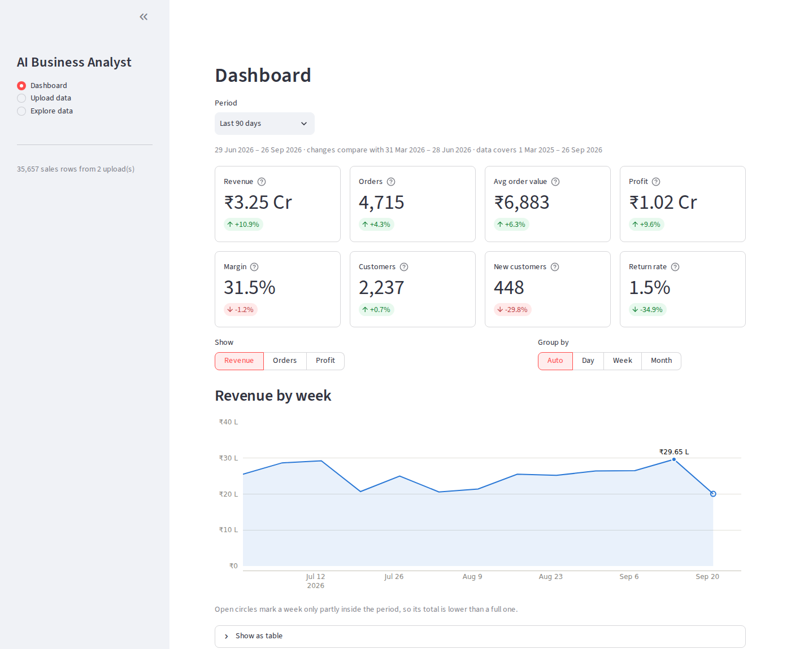
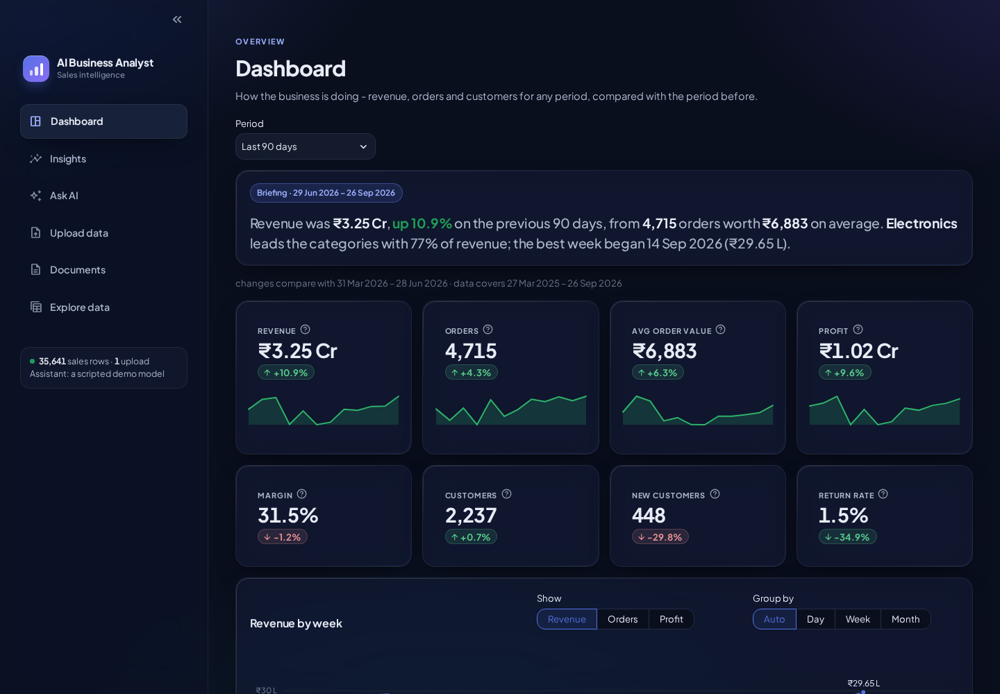
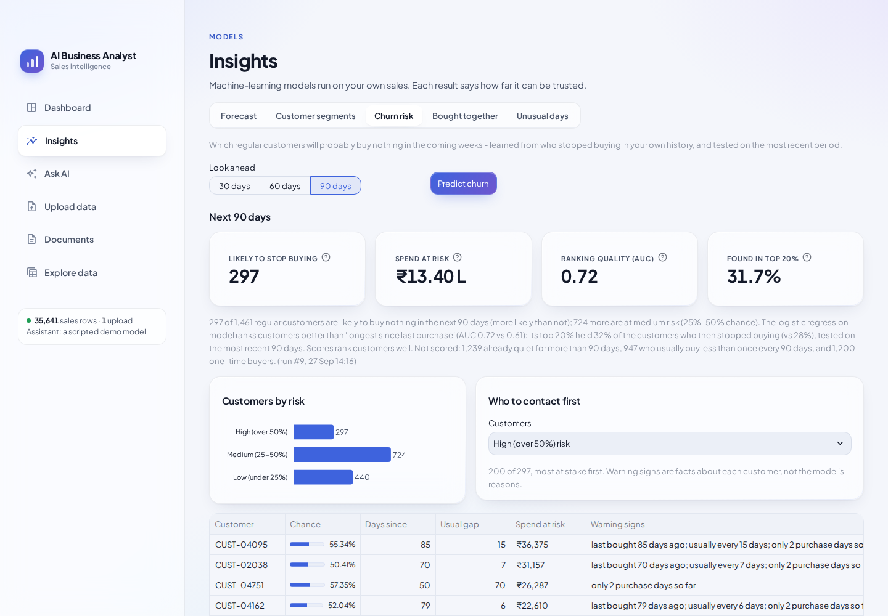
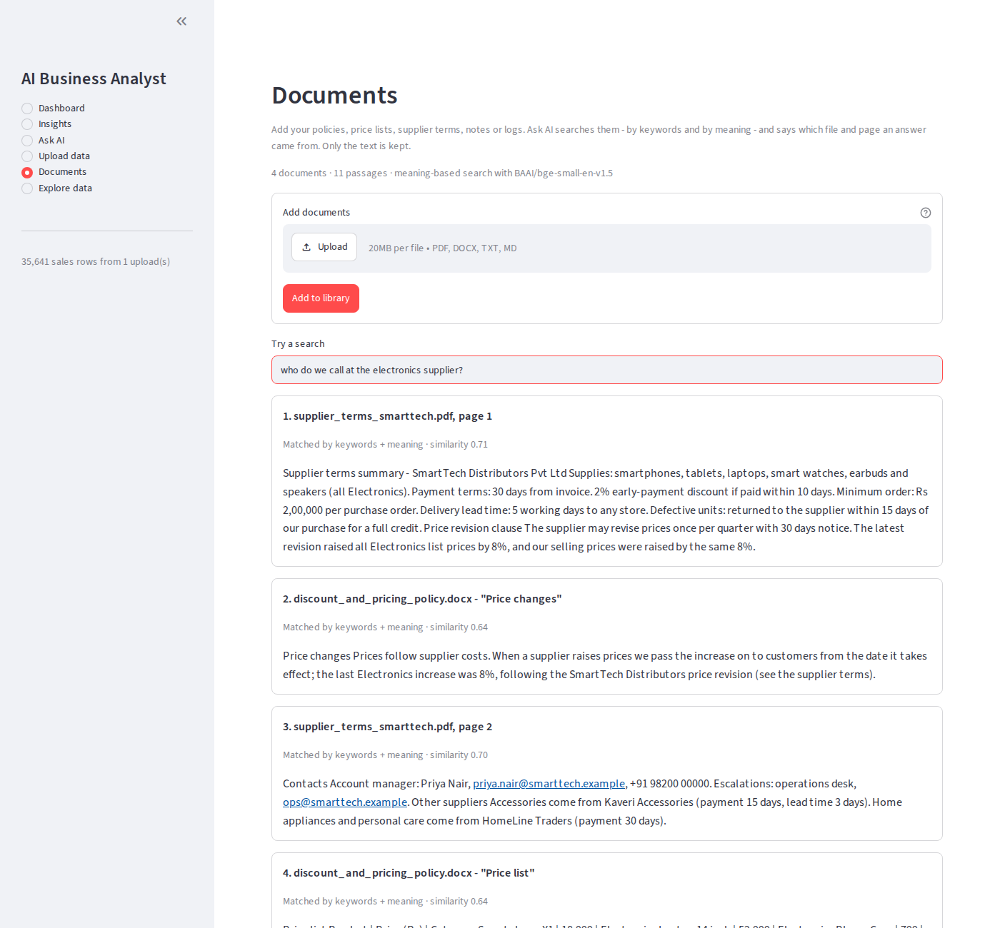
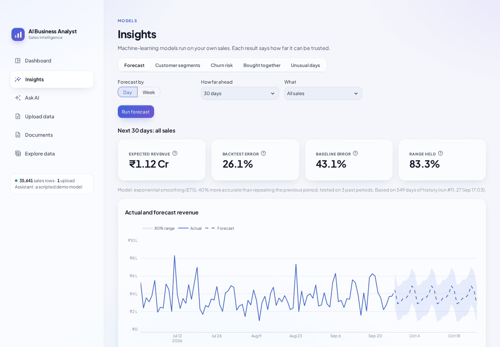
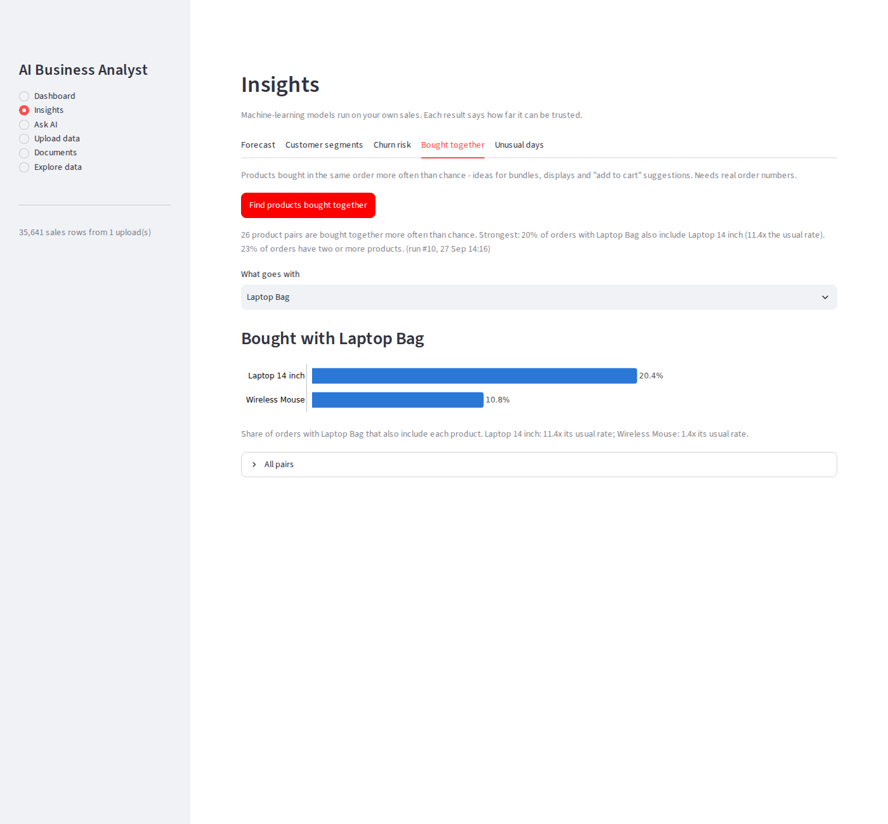
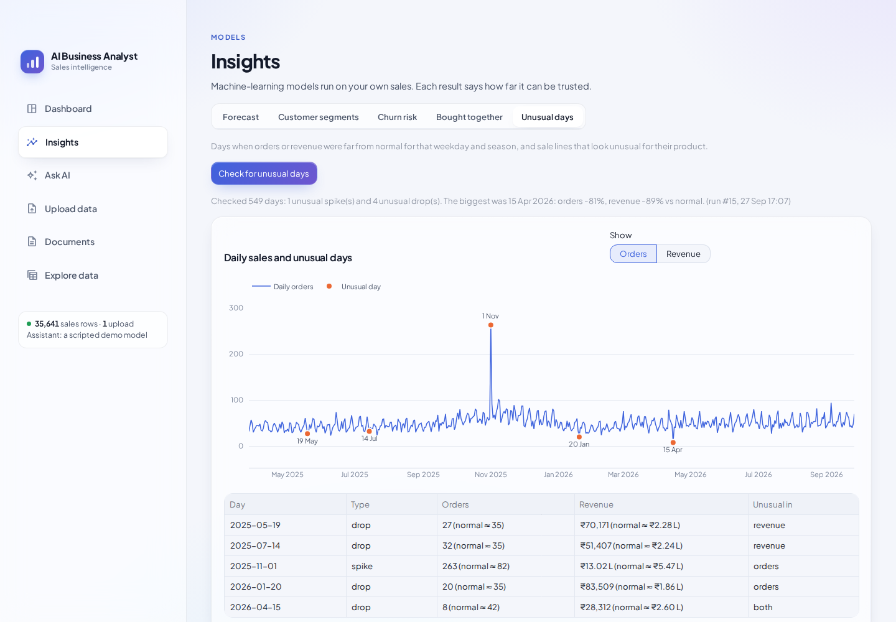
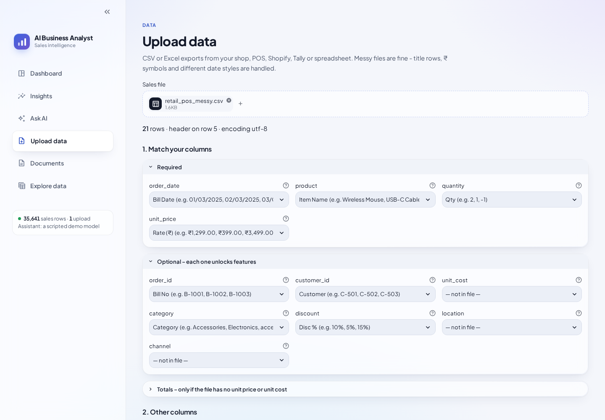

# claude-cloud

> **The project is now a local assistant** (`app/`): Zen, a chat assistant on a local model (Gemma 4 via
> llama-server) with helpers for the web, your documents, your tables and code, each with its own tools,
> inside a workspace that is its sandbox. Run it with `uvicorn app.main:app` and open http://localhost:8000.
> Its design and progress: [docs/TARGET_MAP.md](docs/TARGET_MAP.md) and [docs/ASSISTANT_PLAN.md](docs/ASSISTANT_PLAN.md).
> A full README for it comes with the docs step.
>
> **The first product, below, is kept in [`legacy/`](legacy/README.md)**, working and tested: its API is
> now `uvicorn legacy.main:app --port 8001` and its UI `cd legacy && streamlit run frontend/app.py`
> (with `BIZ_API_URL=http://localhost:8001`).

## AI Business Analyst (legacy)

Upload your sales export, ask questions in plain English, and get answers,
forecasts and charts - running on your own machine.

**Stack:** Python · FastAPI · DuckDB · pandas · scikit-learn · statsforecast · Streamlit · Plotly · LangGraph · Claude (Anthropic API; a local model via Ollama is planned) · RAG with fastembed

> Status: **week 5 of 6 done** - data pipeline, REST API, dashboard, upload UI, ML insights
> (forecast, segments, churn, bought together, anomalies), the AI assistant and document search.
> The design for everything else is in [docs/ARCHITECTURE.md](docs/ARCHITECTURE.md).





## What works today

* **Ask AI** - ask about your sales in plain English ("how did revenue change over
  the last 3 months?", "which customers are we about to lose?"). A LangGraph agent
  answers with tools: read-only SQL over your data, headline KPIs, an exact
  calculator and business formulas, charts, and the forecast / segment / anomaly
  models. Every number comes from a tool, each step (with its SQL and result table)
  is shown above the answer, answers stream in, and follow-up questions remember the
  conversation. AI-written SQL passes a parser-based guard (one SELECT, allowed
  tables only, row and time limits) and the database refuses file access anyway.
* **Document search (RAG)** - add your policies, price lists, supplier terms and notes
  (PDF, Word, text, Markdown). Ask AI searches them by keywords *and* meaning (BM25 +
  a small local embedding model, merged by rank fusion) and cites the file and page, so
  "why was 15 April so slow?" gets the answer from your incident log.
* **Churn risk** - which regular customers will probably buy nothing in the next 30, 60
  or 90 days, learned from who stopped buying in your own history, with each customer's
  warning signs and spend at risk. It is tested against the simple rule "longest since
  last purchase" and says plainly when it isn't much better (on the demo data: AUC 0.72
  vs 0.61 at 90 days).
* **Bought together** - product pairs bought in the same order more often than chance,
  with how often and how many times the usual rate (it finds every pairing planted in
  the demo data, and nothing else).
* **Sales forecast** - exponential smoothing and Theta models are backtested against
  "repeat the previous period" on your own history; the winner forecasts the next
  days or weeks with an 80% range, and the screen shows how much better than the
  baseline it was (on the demo data: 40% more accurate).
* **Customer segments** - KMeans on recency, frequency and spend finds Champions,
  Loyal, At risk, Occasional and Lost customers, with what each group means, what to
  do about it, and the customer lists.
* **Unusual days and sales** - flags days when orders or revenue were far from normal
  for that weekday and season (it finds the demo data's planted flash sale and
  outage), and sale lines whose price, quantity or discount is odd for the product.
* **Dashboard** - revenue, orders, average order value, profit, margin, customers,
  new customers and return rate for any period, each compared with the period
  before (only when the data fully covers it, so a half-empty year never shows as
  +100% growth). Trend by day / week / month with partial weeks marked, and
  breakdowns by category, product, location, channel, weekday or any custom column.
  Every chart has a table view; light and dark mode.
* **Upload with a mapping screen** - drop in a CSV or Excel file, check how its
  columns were matched, keep or rename extra columns, save the mapping for next time.
  Rejected rows are listed with the reason and the file row number.
* **Reads real, messy exports** - title lines above the header, unknown encodings,
  `;` delimiters, `₹1,23,456.50` amounts, day- or month-first dates, `Total` rows;
  built-in formats for Shopify, the Superstore dataset and UCI Online Retail.
* **One standard format** - 4 required columns (`order_date`, `product`, `quantity`,
  `unit_price`), 7 optional ones that unlock features (customer → churn, cost →
  profit, ...), plus any custom columns.
* **REST API** - every screen is built on documented endpoints (OpenAPI at `/docs`),
  including a streaming chat endpoint (server-sent events).
* **A designed interface** - light and dark themes built as one system: self-hosted
  Plus Jakarta Sans (no font CDN), cool slate neutrals with one indigo accent, frosted
  glass cards with a light-catching hairline edge, a written briefing on the dashboard
  and sparkline KPI tiles. Chart colors are checked with a palette validator (contrast,
  color-blind separation) against the actual card surfaces in both modes.
* **Demo data** - one click loads 18 months of realistic synthetic sales with trends,
  seasonality, customer churn, basket patterns and anomalies planted for the ML.













## Quick start

```bash
python -m venv .venv && source .venv/bin/activate
pip install -e ".[dev]"

export ANTHROPIC_API_KEY=...      # for Ask AI (everything else works without it)
uvicorn legacy.main:app --port 8001   # terminal 1: API on http://localhost:8001 (docs at /docs)
cd legacy && streamlit run frontend/app.py   # terminal 2: UI on http://localhost:8501 (BIZ_API_URL=http://localhost:8001)
```

Open the UI and click **Load demo data**, or upload one of the files in
[`data/samples/`](data/samples/). Run the tests with `pytest` (no API key needed:
the assistant is tested with a scripted model).

Settings (environment variables): `BIZ_DB_PATH` (default `data/business.duckdb`),
`BIZ_API_URL` for the UI (default `http://localhost:8000`), `BIZ_CURRENCY` (default `₹`),
`BIZ_DEFAULT_DATE_ORDER` (`dayfirst` or `monthfirst`), `BIZ_MAX_UPLOAD_MB` (default 100),
`BIZ_LLM_MODEL` (default `claude-opus-5`), `BIZ_LLM_EFFORT` (optional: `low` … `max`),
`BIZ_CHAT_DB_PATH` (chat history, default `data/chat.sqlite`), `BIZ_EMBED_MODEL` (default
`BAAI/bge-small-en-v1.5`, downloaded once, ~65 MB) and `BIZ_EMBED_CACHE_DIR` (default `data/models`).

Sample documents for the demo shop: the **Load sample documents** button on the Documents page,
or `python -m legacy.rag.samples data/samples/docs` to write them to a folder.

Command-line upload, without the UI:

```bash
python -m legacy.ingestion.cli data/samples/retail_pos_messy.csv
```

## API

| Endpoint | Purpose |
|---|---|
| `POST /uploads/preview` | Upload a file → detected layout + suggested column mapping |
| `POST /uploads` | Confirm (optionally edited) mapping → clean and load → report |
| `POST /uploads/demo` | Load synthetic demo data |
| `GET /uploads` · `GET /uploads/{id}` · `GET /uploads/{id}/rejected` · `DELETE /uploads/{id}` | History, details, rejected rows, undo |
| `GET /dashboard/summary` · `/trend` · `/breakdown` | KPIs with comparison, trend, top-N breakdowns |
| `GET /sales` | Browse and filter sales rows |
| `GET /schema` · `PATCH /schema/{column}` | Column meanings (read by the AI later) |
| `GET /profiles` · `DELETE /profiles/{name}` | Saved column mappings |
| `POST /ml/forecast` · `/ml/segments` · `/ml/churn` · `/ml/basket` · `/ml/anomalies` | Run a model in the background |
| `GET /ml/runs/{id}` · `GET /ml/forecast` · `/ml/segments` · `/ml/churn` · `/ml/basket` · `/ml/anomalies` | Run status and results |
| `GET /documents` · `POST /documents` · `GET /documents/search` · `DELETE /documents/{id}` | Document library: list, add, search, delete |
| `GET /chat/status` · `POST /chat` · `GET /chat/threads/{id}` | Assistant setup, ask (streams events), conversation history |
| `GET /health` | Status |

## Project layout

```
app/
  main.py              FastAPI app
  agent/               AI assistant: LangGraph graph, tools, SQL guard, prompt, model providers
  api/                 routers (uploads, data, dashboard, ml, chat), request/response models, staging
  analytics/           KPI, trend and breakdown queries (shared by the API and the agent)
  ml/                  forecast, segments, churn, bought together, anomalies, run bookkeeping
  rag/                 document extraction, chunking, embeddings, hybrid search, sample documents
  ingestion/           standard format, reader, parsers, mapper, cleaner, loader, CLI
  db/                  DuckDB connection, numbered migrations, column registry
  datagen.py           synthetic sales data generator
frontend/
  app.py               Streamlit entry point
  client.py            HTTP client for the API
  theme.py             design system: tokens, glass surfaces, navigation, shared components
  charts.py            Plotly styling and number formatting (₹ lakh / crore)
  static/fonts/        self-hosted fonts (SIL Open Font License)
  views/               dashboard, insights, Ask AI, upload, documents, explore pages
data/samples/          small example exports
docs/                  architecture and screenshots
tests/                 pytest suite (pipeline, analytics, ML, RAG, agent, API, UI smoke tests)
```

## Roadmap

| Week | Scope | |
|---|---|---|
| 1 | Data format, cleaning pipeline, DuckDB, samples, synthetic data | ✅ |
| 2 | FastAPI endpoints, dashboard, Streamlit upload and explore screens | ✅ |
| 3 | ML: sales forecast, customer segments, anomaly detection | ✅ |
| 4 | LangGraph agent with SQL, calculator, metrics, chart and ML tools; streaming chat | ✅ |
| 5 | Document search (RAG), churn prediction, bought together, as agent tools too | ✅ |
| 6 | Local LLM with Ollama in Docker, evaluation set, demo | |
