<div align="center">


# Zen harness

**A personal assistant that gets real work out of an open model you run yourself.**

[](https://github.com/AryThakar/Zen-harness/releases/latest)
[](https://github.com/AryThakar/Zen-harness/actions/workflows/ci.yml)


[](LICENSE)

[**Download for Windows**](https://github.com/AryThakar/Zen-harness/releases/latest) ·
[Teaser, 40 s](https://arythakar.github.io/Zen-harness/teaser.mp4) · [A real session](https://arythakar.github.io/Zen-harness/demo.mp4) · [How it works](docs/ARCHITECTURE.md)

</div>

<a href="https://arythakar.github.io/Zen-harness/teaser.mp4">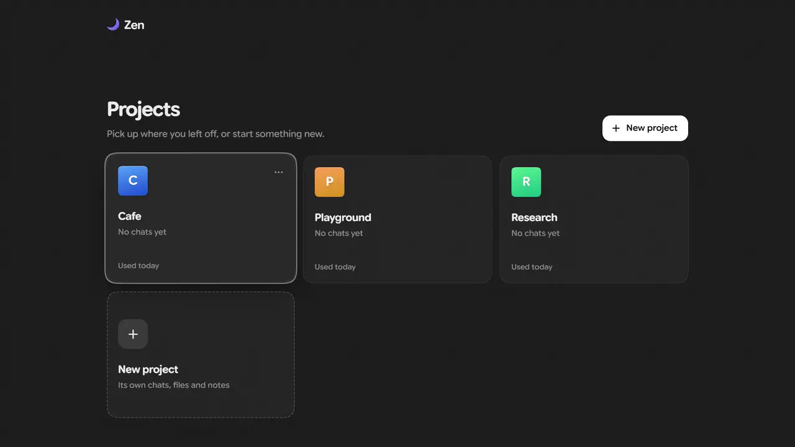</a>

<p align="center"><sub>Recorded live on the real model; the waits while it thinks are sped up. <a href="https://arythakar.github.io/Zen-harness/teaser.mp4">The whole teaser, 40 s with sound</a> · <a href="https://arythakar.github.io/Zen-harness/demo.mp4">a real session, 80 s</a></sub></p>

Zen talks with you and hands focused work to three helpers - one for the web, one for your documents and earlier
chats, and an analyst-programmer for your tables and programs - inside a **project**: one folder of real files.
What must be right - facts, numbers, files, a game that actually starts - is checked by code before you see it, not
left to the model.

It runs on **Qwen 3.6 35B-A3B** through llama.cpp: on your own GPU, or free on a Kaggle notebook's two T4s reached
through a small bridge (the notebook is in [`kaggle/`](kaggle/)).

## What it does

- **Chat** with a persona and a standing memory (`agent.md`: one short file of your instructions and facts, kept in
  view in every chat); every earlier conversation stays searchable.
- **Analyse tables** - inspect and clean them, exact numbers by SQL, live charts, whether a difference is real,
  forecasts, models of what drives a column, segments, unusual values, what a text column says.
- **Research the web** - search and read pages, PDFs, GitHub, YouTube and wikis; cite only pages it read; bring a
  page's table in as data rather than retyping it.
- **Work with your files** - point at one with `@`, or pin it to a chat; read long PDFs with sources you can click
  (`[Source: spec.pdf, p. 312]` opens the PDF at that page).
- **Write and run programs** - Python in a sandbox, or run it yourself in a console; a page or game it writes is
  tried in a real browser before it's called ready, and opens from its card.
- **Make things** - Word documents and slides from Markdown with charts in them, pictures, diagrams.
- **Ask before acting** - downloads, deleting and changing your own files wait for your click.

<table>
<tr>
<td width="50%">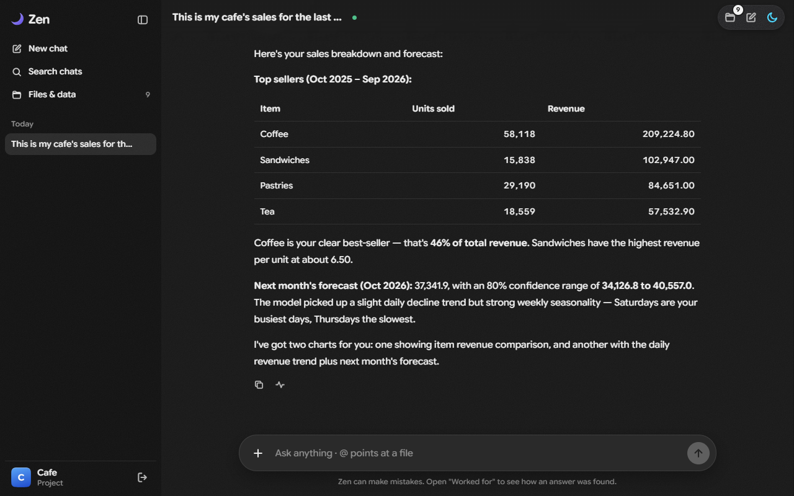<br><sub><b>Ask your data</b> - a year of cafe sales: what sells best, and next month's revenue with its range</sub></td>
<td width="50%">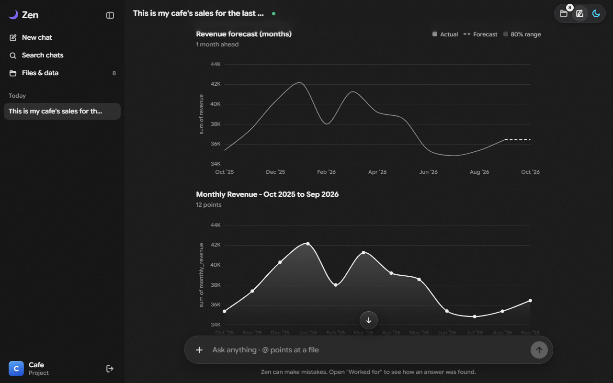<br><sub>The same answer's live charts and forecast, drawn from the file - every number from a tool</sub></td>
</tr>
<tr>
<td>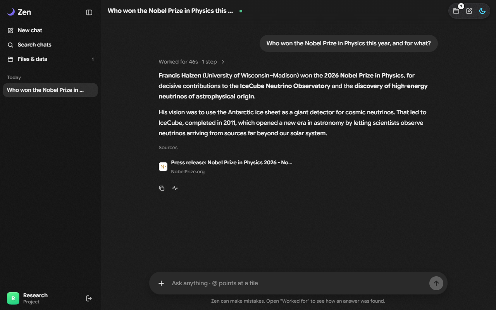<br><sub><b>Research with sources</b> - it reads the pages, and cites only what it read</sub></td>
<td>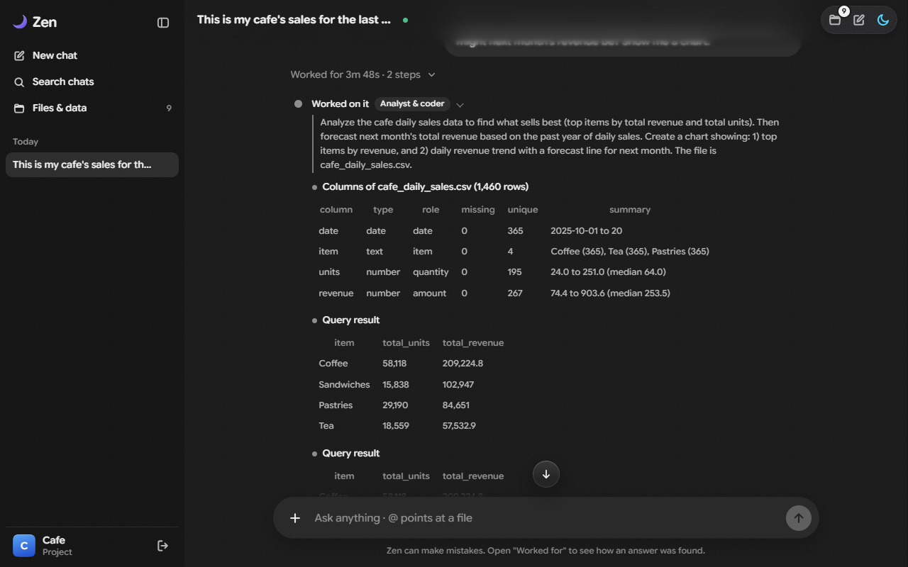<br><sub><b>See how it was found</b> - every step and its result, folded away once the answer is done</sub></td>
</tr>
<tr>
<td>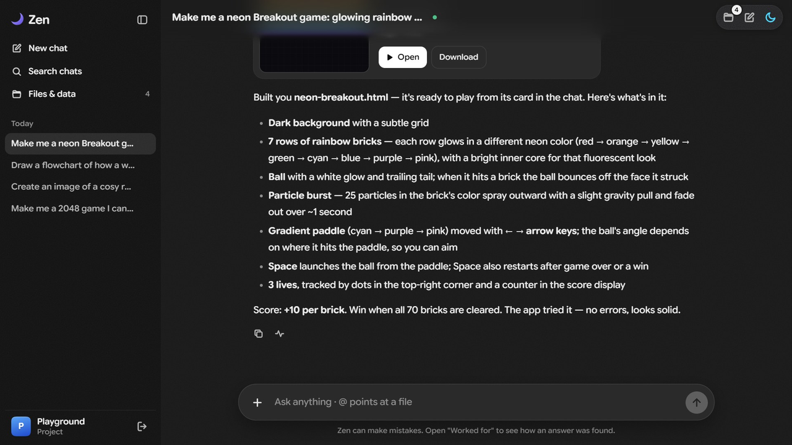<br><sub><b>Build things that run</b> - a game, tried in a real browser before it's called ready</sub></td>
<td>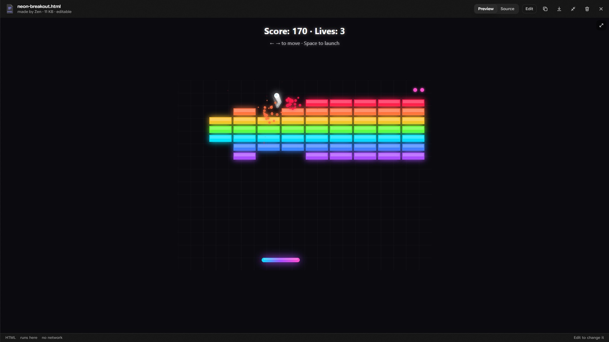<br><sub>It opens from its card and plays right there - this one, Zen's first try</sub></td>
</tr>
<tr>
<td>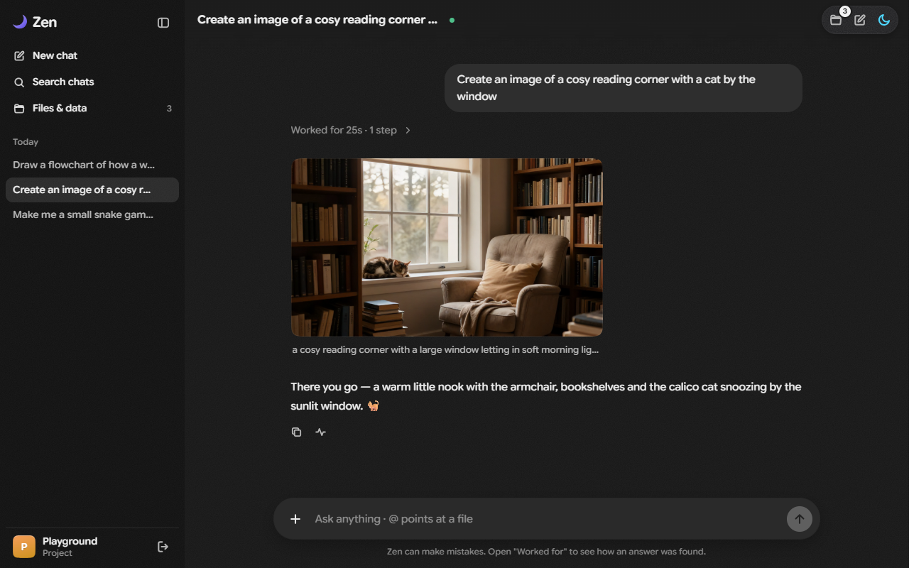<br><sub><b>Pictures</b>, made in the chat</sub></td>
<td>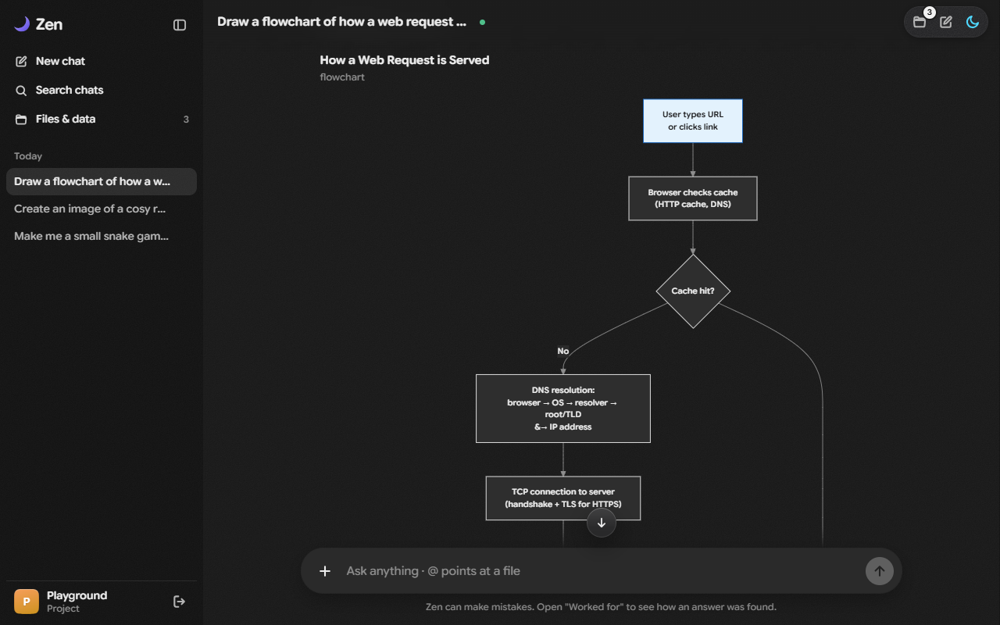<br><sub><b>Diagrams</b>, drawn from Mermaid and kept readable in either theme</sub></td>
</tr>
<tr>
<td>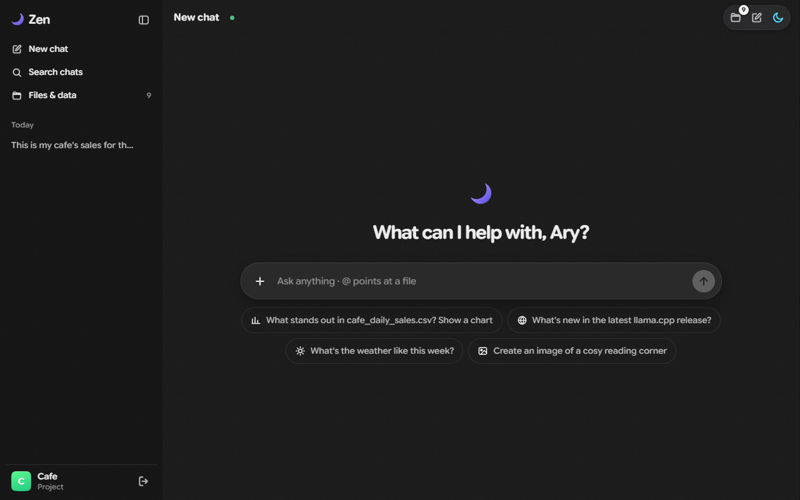<br><sub><b>Start a chat</b> - suggestions from the project's own files</sub></td>
<td>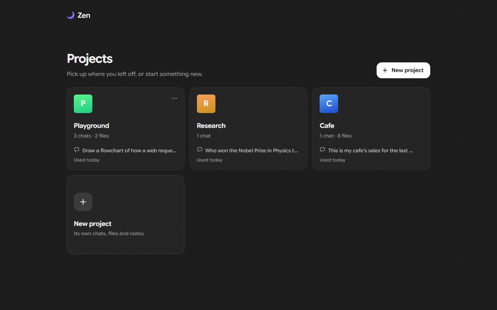<br><sub><b>Projects</b> - each its own chats, files and notes</sub></td>
</tr>
</table>

On a phone it has its own layout:

<p>
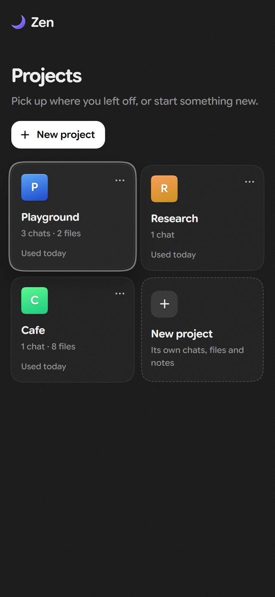
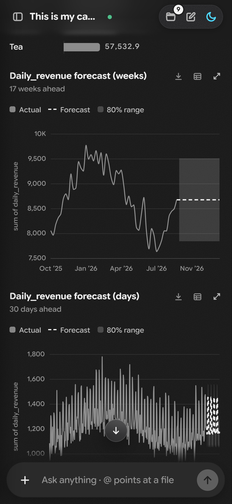
</p>

## How it works

```
browser (web/)  --HTTP + server-sent events-->  FastAPI (app/)
                                                     |
                                     main's turn  -- model slot 0
                                       7 tools of its own + 3 helpers
                   +----------------------+--------+---------------------+
              research_web          ask_knowledge          analyze_or_code      -- model slot 1
              web helper            knowledge helper       analyst-programmer
                   |                      |                      |
              app/tools/ - plain functions with direct tests, no model inside
                   |
     project folder (files by path, versions, reports) + search index + chat store
```

- **main** answers and routes; each **helper** has only its own tools, a step limit and a contract, and hands back
  one checked result. A web answer must cite pages it read; every number in an analysis must come from a tool's
  result; a page must open, respond to its controls and draw something.
- **Guards before a call** stop what is unsafe or likely wrong and say why (with `confirm: true` as the way out
  where it is a judgment); **checks after a reply** send it back once, quietly, when it claims what no tool did.
- **A reply is one flow** in the order things happened - words, steps, cards - with a head on top that says what
  is going on and folds the work away when the answer is done.

The whole design: [docs/ARCHITECTURE.md](docs/ARCHITECTURE.md). Every guard, check and known limit:
[docs/SYSTEM_MAP.md](docs/SYSTEM_MAP.md). How it was built, phase by phase, with what was measured:
[docs/history/](docs/history/).

## Run it

### The Windows app - the quickest way

1. Download `Zen-harness-1.0.0-windows-x64.zip` from the [latest release](https://github.com/AryThakar/Zen-harness/releases/latest)
   and unzip it anywhere (it needs no install: Python, its libraries and the browser tools are inside).
2. Start the model on Kaggle (step 2 below, *On Kaggle*, point 1 only).
3. Double-click **Zen-harness.exe** and paste the address and password the notebook printed. Zen opens in a window of its
   own; closing it stops Zen. Your projects stay in the folder's `data\`; other settings go in `settings.env`.

The notebook prints a new address each time it starts: Zen-harness.exe notices and asks again, and while Zen runs, a
click on the model's name at the top of a chat takes the new one - the chat carries on. To build the folder yourself:
`.venv/Scripts/python.exe desktop/build.py --zip` (it copies this venv's Python and libraries - nothing is downloaded -
and compiles [`desktop/Zen.cs`](desktop/Zen.cs) with the C# compiler every Windows has).

### 1. The app (from source)

Python 3.11 or later (tested on 3.13), on Windows:

```bash
python -m venv .venv
.venv/Scripts/python.exe -m pip install -r requirements.lock -e .
copy .env.example .env
```

`requirements.lock` holds the exact versions the tests passed with. Fill in `.env` as you like (see Settings);
nothing in it is required to start.

### 2. The model - on Kaggle (free) or your own GPU

**On Kaggle**, with no GPU of your own:

1. Open [`kaggle/zen-qwen36-server.ipynb`](kaggle/zen-qwen36-server.ipynb) on Kaggle (*File → Import notebook*), set
   *Accelerator* to `GPU T4 x2` and *Internet* to `On`, and *Run All*. It downloads llama.cpp and the model (about
   21 GB) and prints an **address** and a **password**.
2. Copy `kaggle/bridge.env.example` to `kaggle/bridge.env` and paste them in.
3. Run the bridge: `.venv/Scripts/python.exe kaggle/bridge.py` - the model now answers at `127.0.0.1:8080`, as if it
   ran here. A later session's address goes in from Zen itself (the model's name at the top of a chat); the bridge
   takes it on its next request.

**On your own GPU** (about 24 GB of GPU memory for this model), run llama-server with two slots and the vision
projector:

```bash
llama-server -m Qwen3.6-35B-A3B-UD-Q4_K_S.gguf --mmproj mmproj-F16.gguf -c 131072 -np 2 --no-kv-unified \
  -fa on -ctk q8_0 -ctv q8_0 --reasoning-format deepseek --temp 1.0 --top-p 0.95 --top-k 20 --min-p 0.0 --presence-penalty 1.5 \
  --host 127.0.0.1 --port 8080
```

Slot 0 is the conversation, slot 1 the helpers; the app's prompt limit follows each slot's size.

### 3. Start

```bash
.venv/Scripts/python.exe -m uvicorn app.main:app
```

Open http://localhost:8000, make a project, and ask - or start from
[`data/samples/cafe_daily_sales.csv`](data/samples/cafe_daily_sales.csv): *"What sells best, and what might next
month look like? Show me a chart."*

**Optional, recommended:**
- *Search by meaning* - a llama.cpp build that knows EmbeddingGemma 2 and its two files (`embeddinggemma-2-Q8_0.gguf`
  and `mmproj-embeddinggemma-2-Q8_0.gguf`, below); set the three `ASSISTANT_EMBED_*` settings and the app starts it
  itself. Without them, search uses a small CPU model (bge-small, downloaded once).
- *A real browser* - Node and Microsoft Edge, with [Playwright MCP](https://github.com/microsoft/playwright-mcp) in a
  folder of its own (`npm install @playwright/mcp`) named by `ASSISTANT_PLAYWRIGHT_MCP`. It reads pages drawn by
  JavaScript, and it tries the pages and games Zen writes before they are called ready.
- *Pictures* - a key from [enter.pollinations.ai](https://enter.pollinations.ai) as `POLLINATIONS_KEY`.

### The models, and where they come from

| Model | What it does in Zen | Files, and where to get them |
|---|---|---|
| **Qwen 3.6 35B-A3B** (Unsloth's dynamic quant) | The assistant and its helpers; reads pictures | `Qwen3.6-35B-A3B-UD-Q4_K_S.gguf` and `mmproj-F16.gguf` from [unsloth/Qwen3.6-35B-A3B-GGUF](https://huggingface.co/unsloth/Qwen3.6-35B-A3B-GGUF) - the Kaggle notebook downloads them itself |
| **EmbeddingGemma 2** (optional) | Search by meaning across files, chats and pictures | `embeddinggemma-2-Q8_0.gguf` and `mmproj-embeddinggemma-2-Q8_0.gguf` from [ggml-org/embeddinggemma-2-GGUF](https://huggingface.co/ggml-org/embeddinggemma-2-GGUF) |
| **bge-small-en-v1.5** | Search by meaning without EmbeddingGemma (text only, CPU) | [Qdrant/bge-small-en-v1.5-onnx-Q](https://huggingface.co/Qdrant/bge-small-en-v1.5-onnx-Q), downloaded once by fastembed |
| **llama.cpp** | Serves both models | [ggml-org/llama.cpp releases](https://github.com/ggml-org/llama.cpp/releases) - the notebook uses b11474's Linux CUDA build; EmbeddingGemma 2 needs b11515 or later |

## Settings

Environment variables, or lines in `.env` in the project folder (`NAME=value`; it is git-ignored):

| Setting | What it is |
|---|---|
| `BIZ_LLAMACPP_URL` | the chat model's llama-server (default `http://127.0.0.1:8080`) |
| `ASSISTANT_EMBED_SERVER` | llama-server's program, for the embedding server the app starts |
| `ASSISTANT_EMBED_GGUF`, `ASSISTANT_EMBED_MMPROJ` | EmbeddingGemma 2's model file and picture projector |
| `ASSISTANT_EMBED_URL` | where the embedding server listens (default `http://127.0.0.1:8070`) |
| `ASSISTANT_PLAYWRIGHT_MCP`, `ASSISTANT_BROWSER` | Playwright MCP's folder; the browser it drives (default `msedge`) |
| `POLLINATIONS_KEY` | for generating pictures |
| `ASSISTANT_NAME`, `ASSISTANT_USER_NAME` | the assistant's name (default Zen) and yours |
| `ASSISTANT_THINKING` | the model thinks before answering: `on` (default) or `off` |
| `ASSISTANT_MAX_TOKENS` | a reply's limit, thinking included (default 4096) |
| `ASSISTANT_DATA_DIR` | where projects, chats and files are kept (default `data/assistant`) |
| `BIZ_MAX_UPLOAD_MB` | the largest upload (default 100) |
| `BIZ_LLM_PROVIDER` | `gemini`, `nvidia` or `groq` runs the app on a cloud model instead, for testing the harness (default `llamacpp`) |
| `GEMINI_API_KEY`, `NVIDIA_API_KEY`, `GROQ_API_KEY` | that cloud's key; `BIZ_GEMINI_MODEL`, `BIZ_NVIDIA_MODEL`, `BIZ_GROQ_MODEL` pick its model |

## Tests

```bash
.venv/Scripts/python.exe -m pytest
```

671 tests, no model needed (CI runs them on Windows for every push): the tools directly, the conversation and the helpers with scripted models, the API
through its client, and every tool's contract and description against its schema. With Playwright MCP installed,
one test also opens pages in the real headless browser. Measurements on the real model are scripts in `bench/` -
each phase's acceptance and 20 jobs (10 held out) - with their reports beside them.

## Layout

```
Zen-harness/
├── app/                    the server (FastAPI)
│   ├── main.py             the app: the API and the page
│   ├── assistant/          main's turn, its checks, the prompts, every tool's contract, the chat store
│   │   └── workers/        the three helpers: their loop, finish contracts and result checks
│   ├── tools/              the tools, each a plain function: data and charts, forecasts, the web, files,
│   │                       the code sandbox, the browser page check, the project folder and its search index
│   ├── rag/                reading documents, and the embedding model for search by meaning
│   ├── providers/          the model behind both slots: llama.cpp (and clouds, for testing the harness)
│   └── api/                the HTTP API the page talks to
├── web/                    the chat page: plain HTML, CSS and JavaScript modules, no build step
├── kaggle/                 the notebook that serves the model on Kaggle, and the bridge to it
├── desktop/                the Windows app: Zen-harness.exe's source and the script that builds its zip
├── tests/                  671 tests, no model needed
├── bench/                  measurements on the real model, with their reports
├── docs/                   architecture, the system map, the build history, screenshots and videos
├── data/samples/           sample tables to try it on (data/ also holds your projects: git-ignored)
└── examples/               every data tool run on public datasets, without a model
```

Settings live in `.env` (from `.env.example`, git-ignored); exact library versions in `requirements.lock`.

## Status

A working personal project, built and tested on Windows with one user. Known limits are recorded, not hidden: the
model can still over-work a simple question or skip a built tool for a script, the sandbox is a limit for your own
assistant rather than a security boundary, and a Kaggle session ends after about 12 hours (a new one gets a new
address). See [docs/SYSTEM_MAP.md](docs/SYSTEM_MAP.md), section 5.

## Roadmap

- **Everything on Kaggle** - the app and its search model beside Qwen in the notebook, so a computer needs nothing
  installed.
- **Connect by QR code** - the notebook shows a code; Zen-harness.exe or a phone scans it instead of copying an address and
  a password.
- **On a phone** - Zen already has a phone layout; with the app on Kaggle, a phone opens it from the QR code and adds
  it to its home screen.

## License

Zen harness is source-available under the [PolyForm Noncommercial License 1.0.0](LICENSE).

- **Noncommercial use is free** - personal use, study, research, hobby projects, and use by charities, schools and
  public bodies. Keep the license and the `Required Notice: Copyright 2026 AryThakar` line at the top of
  [LICENSE](LICENSE) with any copy.
- **Commercial use is not licensed.** To use Zen harness in a product, a paid service or other commercial work,
  ask [AryThakar](https://github.com/AryThakar) for a commercial license.

The model, llama.cpp and the libraries Zen harness uses are separate works under their own licenses: see
[THIRD_PARTY_NOTICES.md](THIRD_PARTY_NOTICES.md).
