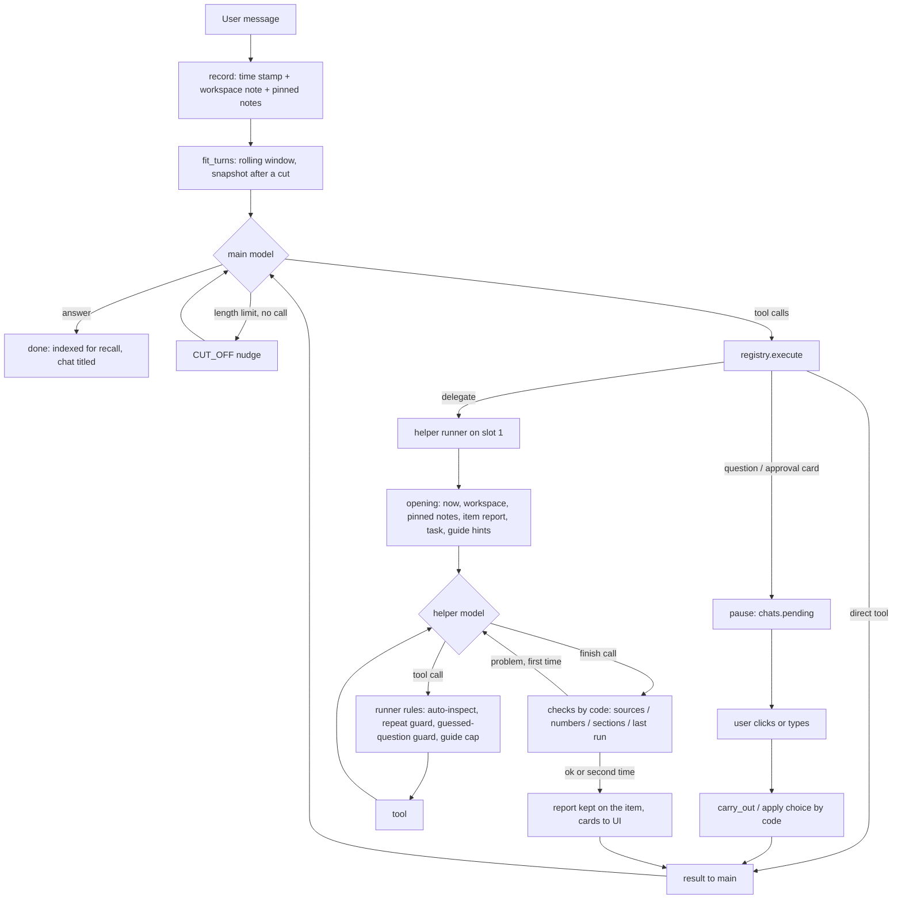

# System map - the assistant as it is (2026-10-04)

> A snapshot from before step 3, kept as the record of where the system pass started. Since then: the
> design in docs/TARGET_MAP.md was built (docs/ASSISTANT_PLAN.md, steps 3.0-3.8), the guides were
> deleted (their craft is in each helper's prompt), and the legacy product moved to legacy/.

Step 1 of the system pass (the user's order: map the current system -> design one coherent target map
-> fixes, restructuring, prompts -> UI -> clean-up of repo, docs and code). This document is the
current state only: what exists and how it really works, read from the code. The target design comes
after it, in its own document.

Evidence tags: **[code]** read in the code (file:function); **[chat]** seen in the user's long test
chat (3431cc69d2ed, 323 messages, analysed 2026-10-04; items I re-checked in code say so);
**[bench]** seen in worker benchmark runs (bench/workers).

---

## 1. The repository holds two products

| | The assistant (live) | "AI Business Analyst" (older product) |
|---|---|---|
| What | Local chat assistant: main + 4 helpers, workspaces, tools | Upload a sales export -> DuckDB -> dashboard, ML insights, a Claude-based chat |
| Code | app/assistant (4 files, 1.6k lines), app/tools (25, 6.3k), app/guides, app/api/assistant.py, web/index.html (2.4k) | app/api (uploads, data, dashboard, ml, documents, chat, schemas), app/agent (graph, tools, prompts, context), app/analytics, app/db, app/ingestion, app/ml, legacy/datagen.py, frontend/ (Streamlit), data/samples, examples |
| UI | web/index.html served at / | Streamlit app (frontend/app.py) |
| Docs | docs/ASSISTANT_PLAN.md | README.md, docs/ARCHITECTURE.md - **they describe only this product** |

Both are wired into the same FastAPI app (app/main.py builds the old database, the old LangGraph chat
with its own SQLite checkpointer, and the assistant's store and slots) [code]. The assistant uses five
pieces of the old code: `app/rag` (document extract, chunking, embedder, stopwords),
`app/tools/table_reader.py` (CSV/Excel reader), `app/tools/sql_guard.py` (query_data's SQL check, still
carrying the old sales tables in its default allow-list), `app/providers/*` (llama.cpp,
scripted). Everything else of the old product is unused by the assistant.

## 1a. Every tool, by who holds it (the tool tree)

```
User <-> UI (web/index.html) <-> API (/assistant, server-sent events) <-> main (model slot 0)
main - 11 tools
|-- direct (7)
|   |-- files            list | find | read | write | update(*) | rename | delete(*) | download(*)
|   |-- save_note        (pruned by code; 5 latest pinned)
|   |-- get_weather
|   |-- generate_image   (Pollinations)
|   |-- draw_diagram     (Mermaid, mended by code)
|   |-- calculate
|   `-- ask_user(*)
`-- delegates (4) -> helpers on model slot 1, one task each, stateless
    |-- research_web  -> web helper:       web_search, read_webpage                      -> submit_result
    |-- ask_knowledge -> knowledge helper: search_files, recall, read_file               -> submit_result
    |-- analyze_data  -> data helper:      inspect_data, clean_data, query_data, make_chart,
    |                                      stats_test, train_model, predict, forecast,
    |                                      calculate, run_code, fix_code, guide          -> save_report
    `-- write_code    -> coder helper:     run_code, fix_code, read_file, guide          -> save(*)
(*) pauses the turn for the user's click (approval or question)

Done by code, never by a model: approval.carry_out (download, table import, delete, replace),
_apply_choice (a cleaning option the user clicked), the runner's automatic inspect_data, report facts,
store_file (uploads and downloads), index_report, notes.prune, remember_turn (every turn into recall).
```

27 distinct tools (shared: calculate - main and data; read_file - knowledge and coder; run_code,
fix_code, guide - data and coder) + 3 finish tools; files has 8 modes.

## 1b. The system flow



## 1c. The workspace is the boundary (the user's model: a workspace is a project and a sandbox)

Already true in the code [code]: each workspace has its own folder with its files, tables, models,
images, notes, the scripts' sandbox folder and one search index (documents, reports, notes, the
turns of all its chats); its chats belong to it; deleting it deletes all of that. Global, shared by
every workspace: the model, the guides, the embedding model, the settings. Gaps against the rule
"everything works inside the workspace, nothing outside":
- recall leaves out the **current** chat (memory.recall's exclude_conversation), so the note "N
  earlier turns of this chat are not shown; find them with ask_knowledge" can never work: the cut
  turns of the chat itself are unreachable [code - verified].
- Scripts have network access: data can leave the workspace and files can enter it without the
  approval card [code, chat].

## 2. Runtime

| Part | What runs | Settings that matter |
|---|---|---|
| Model | llama-server: Gemma 4 E4B (Q4_K_XL) + MTP draft model; **vision projector loaded since today** (mmproj-vision-Q8_0, 230 MB, audio removed) | 2 slots x 16,384 tokens (slot 0 main, slot 1 helpers); thinking on; reply limit 4,096 tokens **including thinking**, both slots (config.assistant_max_tokens) [code] |
| API | FastAPI (app/main.py), assistant routes in app/api/assistant.py | one turn at a time for all chats (a process-wide lock); events by server-sent events; Stop sets one event checked on every streamed line [code] |
| Embeddings | bge-small-en-v1.5 via fastembed, shared | document/notes/chat search, guide search |
| Image generation | Pollinations API (external, needs the user's key) | 1 image per call |
| Web | ddgs search engines (no key); page fetch with public-address checks | |
| Scripts | a separate Python process per run, the app's interpreter and libraries | 30 s default, 120 s max; audit hook guards files outside the workspace; **network open** [code: sandbox docstring] |

Fixed prompt cost per role, measured by the server (instructions + tool declarations): main 2,542
tokens (11 tools), data analyst 2,689 (13), coder 1,374 (5), web 648 (3), knowledge 555 (4).

## 3. One turn of main, end to end

1. **The user's message is stored** (main.send -> record): local time stamp + text, plus an app note:
   a workspace snapshot (5 newest items) and the 5 pinned notes on the first message, afterwards only
   the changes (context.message_context). The system prompt `MAIN` never changes, so llama.cpp's cache
   holds [code].
2. **The graph runs** (LangGraph: agent -> tools -> agent ... , MAX_ROUNDS 8) [code]:
   - agent: fit the history into the slot (context.fit_turns: drop oldest turns to 25% under the
     limit; the cut is stored in chats.dropped). After a cut the newest user message is rewritten in the
     store with a fresh snapshot + standing instructions (_snapshot_on_newest). Then one model call.
   - A reply stopped by the length limit with no tool call gets the hidden nudge CUT_OFF and another
     round [code].
   - tools: each call runs through registry.execute. A question artifact (ask_user, an approval
     request, a helper's question_for_user, a coder approval card) pauses the turn: stored in
     chats.pending, shown as a card.
3. **The user answers a card** (main.reply): an approval is carried out by code (approval.carry_out);
   a helper's question becomes the helper call's result (with the user's choice applied by code when
   it is a cleaning option, _apply_choice); then the graph continues.
4. **The turn ends** (main._finish): the turn is indexed for recall (memory.remember_turn), a new
   chat gets a title from its first message.
5. **What the UI gets**: events text, tool_start/tool_end, artifact (cards), worker (helper steps),
   question, stats, done/stopped/error; every message and artifact is also a row in the store, so a
   reloaded page replays the chat [code].

Main's own answer checks: the time stamp and the app's bracketed notes are stripped from replies
(STAMP, without_notes); Mermaid blocks in a reply are mended (diagram.mend_blocks). **Nothing checks
main's facts or numbers** [code].

## 4. The helpers

All four run through one runner (workers.run_worker) on slot 1. Opening message: now-line + workspace
listing (up to 30 items) + pinned notes + (the file's or table's report) + the user's message + the
task + guide suggestions (data, coder). Each step: shorten old tool results if the prompt overflows,
call the model, run the calls, add nudges [code].

| Helper | Main's tool | Its tools | Steps | Finishes with | Checked by code before main sees it | Main gets | UI gets |
|---|---|---|---|---|---|---|---|
| web | research_web(task) | web_search, read_webpage | 6 | submit_result | sources must be pages it read | answer + URLs | source cards |
| knowledge | ask_knowledge(question) | search_files, recall, read_file | 6 | submit_result | sources must be ones a tool returned; sources credited from passages when missing | answer + sources | passages |
| data | analyze_data(task, data?) | inspect_data, clean_data, query_data, make_chart, stats_test, train_model, predict, forecast, calculate, run_code, fix_code, guide | 10 | save_report | every section written; every number in data used/results/caveats found in a tool result | results + report (kept on the table) | charts, tables, report card |
| coder | write_code(task, file?) | run_code, fix_code, read_file, guide | 8 | save | every section; functions named exist; the last Python run passed (or the facts say it fails) | the file's report, never the code | file card (code, outputs, report) |

Runner rules [code]: a table nobody inspected is inspected first (data); a cleaning step that settles
a question only the user can answer is refused; the same call twice is refused with what to do
instead; a page that failed is blocked by address; at most 4 guide reads; "2 steps left" / "last
step" notes; one chance to fix a failed check; a plain-text answer is taken as the answer (data: one
nudge to save_report first); the coder's working script is kept if it never called save. A helper's
error raised as ToolError (e.g. `_load` refusing an image) reaches main as "write_code stopped with an
internal error (ToolError)" [code, chat].

## 4a. How the data helper's tools are really used

Counted 2026-10-04 from every benchmark run (191 analyst runs, bench/workers/results_*.json) and from
the app's own chats (cards each tool sent to the UI, and the analyst's reports):

| Tool | Benchmark runs using it | App chats (cards) | When it is used |
|---|---|---|---|
| inspect_data | 91% | 7 | nearly always (the runner also forces it) |
| query_data | 86% | 8 | the workhorse |
| clean_data | 26% | - | when inspect_data suggests steps |
| calculate | 14% | - | arithmetic on query results |
| run_code / fix_code | 7% / 2% | 18 / 5 | charts it can't draw, ML (the user's ML request went here, not to train_model) |
| make_chart | 6% | 3 | only when the task says "chart" |
| stats_test | 6% | 1 | only when the task says "test it" |
| train_model | 6% | **0** | only when the task says "train a model" |
| forecast | 6% | **0** | only when the task says "forecast" |
| predict | **0** | **0** | never, anywhere |
| guide | 15% | - | added 2026-10-04 |

In practice the analyst is inspect_data + query_data. The ML and statistics tools are engineered with
care (baseline comparison, time-based splits, leak detection, backtests with ranges, rank-based tests
with effect sizes - ported from the analyst project) but are reached only when a task names them, and
the model writes its own scikit-learn code in run_code when it isn't told (run_code's description lists
sklearn, xgboost, lightgbm). predict needs a model id and a matching table: a two-step flow nothing
leads to. The old product's business ML (app/ml: churn, segments, basket, anomalies) isn't reachable
from the assistant at all.

## 5. Tool inventory

Main's direct tools (7) and delegates (4), then the helpers' tools. "Names" = how the tool accepts an
item: by id only, or by id or name.

| Tool | Who | What it does | Names | To the model | To the UI | Side effects / permission |
|---|---|---|---|---|---|---|
| files | main | list (15 a page) / find / read (report first, then 50 lines) / write (new only; .docx from Markdown) / update (whole or lines; the user's own file asks) / rename / delete (asks) / download (GitHub file or a data table from any site; asks) | id or name (fuzzy "Close:" hint) | JSON | file card | writes workspace; approvals |
| save_note | main | a note; same title updates; 5 latest pinned; pruning by count/length/age | title | JSON | note card | index |
| get_weather | main | now / daily forecast for a place (IP location when none) | - | JSON + "shown" | weather card | web (Open-Meteo, ipwho.is) |
| generate_image | main | an image from a prompt | - | id, size + "shown" | image | web (Pollinations), workspace |
| draw_diagram | main | Mermaid, checked and mended | - | JSON + "shown" | diagram | - |
| calculate | main, data | safe arithmetic (simpleeval + functions) | - | JSON | - | - |
| ask_user | main | a question with option buttons | - | the answer, on resume | question card | pauses the turn |
| research_web / ask_knowledge / analyze_data / write_code | main | a helper (section 4) | data: id | the helper's checked result | helper steps + cards | as the helper's tools |
| web_search | web | titles, links, snippets (ddgs) | - | JSON | evidence | web |
| read_webpage | web | readable text of a page (HTML, text, PDF; YouTube metadata), focused by find | - | JSON | source card | web |
| search_files | knowledge | passages from documents + reports; notes searched apart (best 1-2), oldest first | - | JSON | passages | - |
| recall | knowledge | earlier chat turns, oldest first | - | JSON | passages | - |
| read_file | knowledge, coder | a file or note in parts of ~12,000 chars (code numbered) | **id only** | JSON | - | - |
| inspect_data | data | columns, types, issues, suggested clean_data steps, questions | id only | JSON | table | caches the inspection on the table |
| clean_data | data | 11 step types on a copy -> new table + log | id only | JSON | table | new table |
| query_data | data | one DuckDB SELECT (guarded), save=true -> new table | ids in SQL | JSON (50 rows) | table | new table |
| make_chart | data | line / bar / scatter / histogram, aggregation built in | id only | summary numbers | chart | - |
| stats_test | data | difference / correlation / association; test chosen by code | id only | JSON | table | - |
| train_model / predict | data | linear vs boosting against a baseline; leak check; importances / scores new rows | id only | JSON | table | model / new table |
| forecast | data | ETS/Theta vs seasonal naive, 80% range, reliability | id only | JSON | forecast chart | - |
| run_code / fix_code | data, coder | the helper's scratch script, whole or by lines; numbered error context | ids or original names in the script | output, errors, files | code fold | files the script writes become items; **network open** |
| guide | data, coder | a section by id, or search (keywords + meaning) | section id | Markdown | - | - |
| submit_result / save_report / save | helpers | the finish (section 4) | - | checked | report/file card | report on the item; file saved |

Not model tools: approval.carry_out (runs an approved action), files.store_file (uploads, downloads),
memory.remember_turn, files.index_report, notes.prune, web.fetch_icon / fetch_image (UI cards).

## 6. Workflows by what the user works with

**Files**: upload or approved download -> store_file decides by type: a table (CSV/Excel -> typed,
Parquet), a document (PDF/Word/text/Markdown -> extracted, ~250-word passages, indexed), or a plain
file -> listed in snapshots and files(list) -> read with files(read) (main) or read_file (helpers):
two readers with different paging (50 lines vs 12,000 characters) and different naming -> changed with
files(update) (approval for the user's own files) or by the coder's save -> renamed / deleted
(approval). Scripts never change stored items; what they write becomes new items.

**Tables**: inspect_data (cached) -> clean_data (new table) -> query_data (numbers; save=true for a
derived table) -> make_chart / stats_test / train_model / predict / forecast -> save_report keeps the
report on the table; the next task on it starts from that report.

**Code**: write_code(task, file?) -> the coder's scratch script (the given file loaded into it) ->
run_code / fix_code -> save(name, report) -> file card; the user's own file waits for approval. Other
languages are saved as written ("not run"). The script's outputs (images, CSVs) are linked to the file.

**Images**: generate_image (from text only). Figures a script makes become image items. There is
**no way to look at an image** (until now no vision; the projector is loaded since today) and **no
way to edit one in place**: files(update) is text only, the coder refuses an image as its file
[code, chat].

**Notes**: save_note -> pruned by code -> the 5 latest pinned: on main's first message and in every
helper's opening -> older ones found by search_files.

**Knowledge**: one search index per workspace holds documents, reports, notes and chat turns;
search_files (documents + reports, notes apart), recall (chats), read_file (whole files).

**Web**: research_web -> web_search -> read_webpage (focused on the latest search when long) ->
cited answer + source cards. Downloads go through files(download), not the web helper.

## 7. Cross-cutting mechanisms: where each one lives

| Concern | Where it lives | One rule or several? |
|---|---|---|
| Item names | workspace (ids), file_ops._exact/_close (names, fuzzy), sandbox _resolve (ids + original names), read_file and data tools (ids only), resolve_column (column names, fuzzy) | **several**: the same item is reachable by name in files() and scripts but not in read_file or data tools; files' "Close:" hint returns the whole list line ("data_1  shop_sales.csv - 6 rows..."), which the model then passes as a name and fails again [code, chat] |
| Errors | core.tool wrapper (ToolError -> message), registry.execute (any other exception -> "internal error (Type)"), helpers' warnings/note/trail | **several**: a ToolError raised outside a @tool function (delegates) becomes "internal error" [code] |
| Permissions | approval.py (download, table import, delete, replace the user's file), sandbox audit hook (outside files, deleting stored items), web public-address checks | download rule has a hole: scripts have network (a coder script downloaded a CSV with requests, no approval) [code, chat] |
| Honesty checks | helpers only (sources; numbers for data; sections, functions, last run for coder); reports' facts written by code | main has none; the coder's report isn't compared with what the script printed [code, chat] |
| Repeats | workers._repeat | main has none (it repeated a failed call) [chat] |
| Context | main: fit_turns + snapshots + standing instructions; helpers: shorten_tool_results; exact counts from the server | hidden nudges count as turns when cutting (context.turn_starts), so a window can start on a nudge [code, chat]; the chat's start time isn't known [chat] |
| Time | stamp on each user message; now-line in helpers' openings | |
| Reports | reports.py (shared layout + facts) for the coder and the analyst; index_report | one rule (good) |
| Search | SearchIndex (FTS5 + embeddings, rank fusion) for documents, reports, notes, chats; the guide's own keyword + meaning engine | two engines, same idea |
| Nudges to the model | CUT_OFF (main, helpers), STEPS_LEFT, NO_MORE_TOOLS (provider), SHOWN (main), auto-inspect, guessed-question, guide cap, repeat messages | scattered across main.py, workers.py, llamacpp.py |
| Thinking budget | none: thinking shares the 4,096-token reply limit | a long think left no visible answer twice; CUT_OFF re-sent the same nudge [code, chat] |

## 8. The prompt layer

| Text | Where | Size |
|---|---|---|
| MAIN (main's instructions) | main.py | 655 words, 886 tokens |
| Helper instructions (4) | workers.PROFILES | 123-349 tokens each |
| Tool descriptions (30) and input field descriptions | registry.py, workers.DELEGATES, workers result models | main's 11 tools 1,656 tokens; the analyst's 13 tools 2,340 |
| Guide catalogs + sections | app/guides/*.md, guide.description | catalog in the tool description; sections on demand |
| Nudges and hints | main.py, workers.py, llamacpp.py, tool results ("next", "note") | short, many |

The same rule is said in several places, in different words. Examples [code]:
- "Never paste or retype code": MAIN + write_code's description.
- "Every number from a tool": MAIN, the data helper's instructions, calculate's description, the
  numbers-check message.
- "Use run_code only for what no other tool does": the data instructions and run_code's description,
  while run_code's description also lists matplotlib and 27 more libraries, and make_chart can't draw
  box plots or grouped bars - the analyst draws with matplotlib [chat].
- When to ask the user: MAIN, ask_user's description, the helpers' FINISH text, the guide.

## 9. The UI (web/index.html, one file)

Sidebar (workspaces, chats) · status · composer with upload · the conversation: user messages,
answers (Markdown, maths, Mermaid), steps and helper sub-steps with their inputs and evidence, cards
(chart, forecast, table, image, diagram, weather, note, file with View / Download / outputs / report,
report, code, question / approval, web sources, passages) · library sheet (items, the 5 pinned notes,
table preview) · dialogs and toasts [code]. While the model thinks, the UI shows only "Thinking...";
the user stopped turns that were still thinking [chat].

## 10. Known problems, by layer

Collected from the code reading, the user's chat and the benchmarks; each needs a decision in the
target map, not a patch now.

**Tools**
- files(read) naming: "id name" not accepted; the "Close:" hint feeds the wrong format back; a rename
  to the same name reports success [code, chat].
- Two readers (files.read for main, read_file for helpers) with different paging and naming [code].
- read_file and the data tools accept ids only [code].
- inspect_data suggests parse_numbers for an id column with leading zeros, and dropping exact copies
  in transaction data where copies can be real purchases (changes the answers) [code, bench].
- make_chart lacks box plots, grouped/stacked bars and several lines [code, chat].
- Repo links: only 10 files listed, no total [code, chat]; raw+blob GitHub links aren't repaired [code, chat].
- Script images are listed as "image NonexNone" (no width/height) [code, chat].
- files(read) start=0 is refused [chat].
- clean_data's step format error said nothing useful (fixed today: steps written as {op: {...}} are
  read, others get a plain message) [code, bench].

**System rules (runner, checks, permissions)**
- Main's facts and numbers are unchecked; invented data went into a chart and then into an
  explanation built on it [chat].
- "Done" claims without evidence: a loop that "printed 1-10" printed its code; a rename that did
  nothing; an image "with the date added" [chat]. The coder's report isn't checked against the output.
- Replies that announce an action ("Starting now...") and stop with no tool call: 9 times [chat].
- Helper ToolErrors reach main as "internal error" [code, chat].
- Scripts have network: downloads without approval [code, chat].
- Main has no repeat guard [chat].

**Context and runtime**
- Thinking shares the 4,096-token reply limit; empty replies; the same cut-off nudge repeated [code, chat].
- Hidden nudges count as turns when cutting; a window started on a nudge without its question [code, chat].
- After many turns, 51 of 60 user turns were out of view; the chat's start time unknown [chat].
- One turn at a time across all chats (by design: two slots).

**Prompts**
- Rules repeated in several places with different wording; tool descriptions and prompts drift [code].
- The analyst prefers run_code + matplotlib over its chart tool [chat].

**UI**
- "Thinking..." only, no sense of progress or time [chat].

**Repo and docs**
- Two products in one app; README and ARCHITECTURE describe the old one [code].
- Module docstrings out of date in places (main.py still says the workspace is in the system prompt) [code].

**Model limits (not for the system to fix)**: long maths derivations, tables from long web pages,
sometimes ignoring "don't use X", stale "latest" picks, general knowledge sent to the web [chat].

## 11. Questions the target map has to answer

1. **One naming contract**: should every tool accept an id or a name (one resolver), and what does a
   "not found" answer look like?
2. **One reader**: merge files(read) and read_file into one reading contract (paging, line numbers,
   reports first)?
3. **Who checks what**: extend the numbers check to main's own answers and to the numbers main writes
   into helper tasks? Check a saved file's report against what its last run printed?
4. **Vision**: a view_image tool - for main only, or also the analyst (to look at its own charts) and
   the coder (to check a figure)? Image editing in place: the coder opening an image by id and saving
   over it with approval?
5. **Scripts and the network**: off by default, so downloads only go through the approval card?
6. **Charts**: grow make_chart (box, grouped/stacked, multi-line) so the analyst never needs
   matplotlib, or allow run_code charts but say so?
7. **Thinking**: a thinking budget per reply, or thinking off on the retry after an empty reply; how
   the UI shows progress.
8. **Errors**: one error contract for all tools and helpers (what failed, why, what to do next).
9. **Prompts**: each rule in exactly one place (instruction, tool description or tool result) - which
   kind of rule goes where.
10. **The old product**: remove it from this repo (keeping the five modules the assistant uses), so
    the repo, README and docs describe one product.
11. **Fundamentals in the helpers' instructions** (the user's idea, 2026-10-04): a short "how an
    expert works" block in each helper's own prompt (stateless helpers, 16k slot, prompt cached per
    role) instead of - or before - the searchable guide tool.
12. **The data helper's tools**: which ones stay, merge or go (predict unused; ML only when named);
    make the analysis features the system offers ones the model actually reaches.
13. **Recall inside the workspace**: let recall find the current chat's own cut turns, so the
    workspace really is the one memory.
